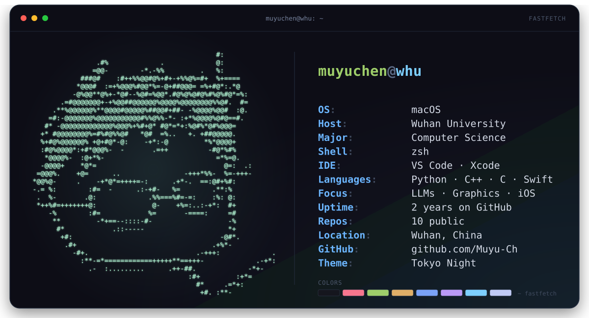

  

## <samp>muyuchen@whu:~$ ls projects</samp>

- **[3DEngine](https://github.com/Muyu-Ch/3DEngine)** — a 3D rendering engine built from scratch. `C++` `SDL2`
- **[AIfit](https://github.com/Muyu-Ch/AIfit)** — an AI-assisted food & calorie tracker for iOS. `SwiftUI`
- **[Monster Eyes](https://github.com/Muyu-Ch/Monster_eyes)** — monster eyes that stretch as you open and close your MacBook lid. `Python`

  <a href="https://github.com/Muyu-Ch?tab=repositories"><strong>all repositories →</strong></a>

