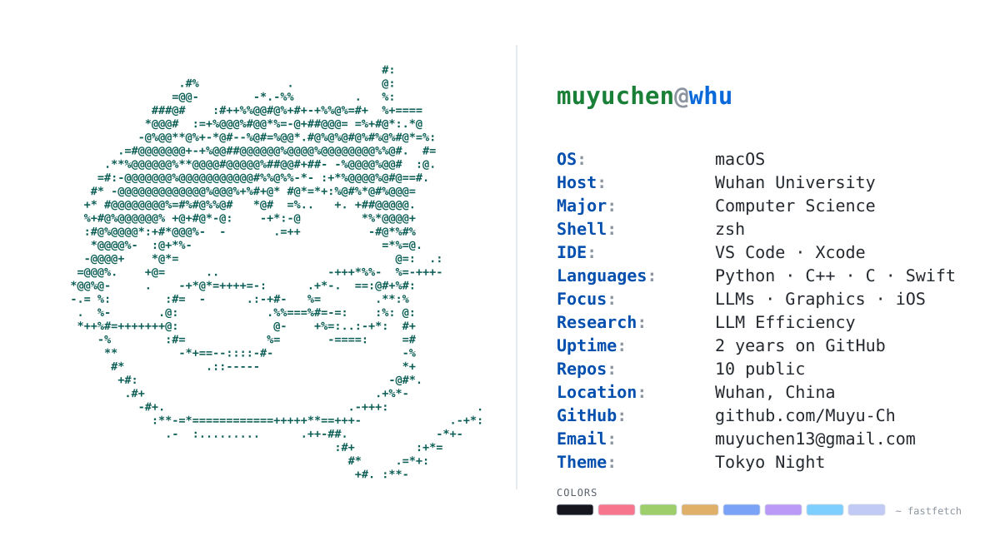

## <samp>muyuchen@whu:~$ fastfetch</samp>

  <picture>
    <source media="(prefers-color-scheme: dark)" srcset="./assets/profile-card-dark.svg">
    <source media="(prefers-color-scheme: light)" srcset="./assets/profile-card-light.svg">
    
  </picture>

## <samp>muyuchen@whu:~$ ls projects</samp>

- **[Zero to Hero](https://github.com/Muyu-Ch/Zero-to-Hero-Chinese)** — Chinese-annotated companion notes for Andrej Karpathy's neural networks course. `Jupyter Notebook`
- **[Monster Eyes](https://github.com/Muyu-Ch/Monster_eyes)** — monster eyes that stretch as you open and close your MacBook lid. `Python`
- **[3DEngine](https://github.com/Muyu-Ch/3DEngine)** — a 3D rendering engine built from scratch. `C++` `SDL2`
- **[AIfit](https://github.com/Muyu-Ch/AIfit)** — an AI-assisted food & calorie tracker for iOS. `SwiftUI`

  <a href="mailto:muyuchen13@gmail.com"><strong>email</strong></a>
  &nbsp;·&nbsp;
  <a href="https://github.com/Muyu-Ch?tab=repositories">all repositories →</a>

